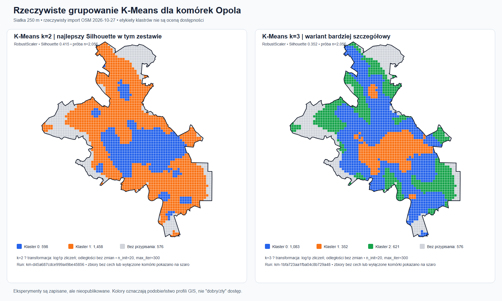
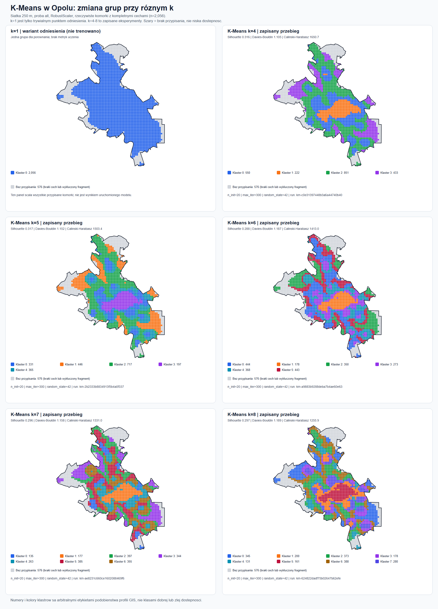
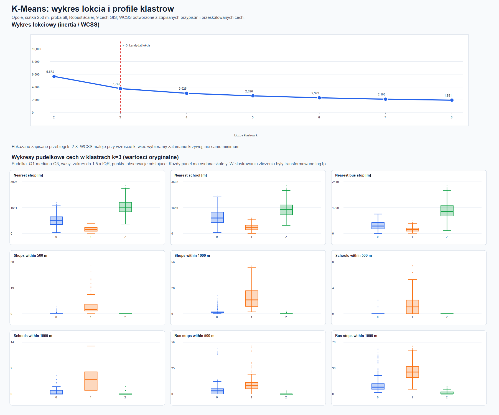

# Notatki 07.11.2026 Etap 5

Mamy 104 zapisane eksperymenty i 107 952 przypisania komórek. Ich skuteczność trzeba jednak opisać ostrożnie: to uczenie nienadzorowane, więc nie mamy etykiet „obszar niedostatecznie wyposażony”, z którymi można porównać wynik i policzyć zwykłą accuracy.

Zapisane metryki pokazują, na ile grupy są rozdzielone matematycznie, ale same nie potwierdzają, że model poprawnie wykrywa niedostatecznie wyposażone obszary:
Model i dane	Najwyższy Silhouette w badanych konfiguracjach	Co jeszcze widać
K-Means, 250 m, wszystkie komórki	0,415	najlepszy wynik był dla k=2; badano k=2–8
K-Means, 500 m, wszystkie komórki	0,417	również najlepszy wynik dla k=2; badano k=2–8
HDBSCAN, 250 m, wszystkie komórki	0,401	konfiguracje tworzyły 2–11 klastrów, szum stanowił 0,5–11,1% próby
HDBSCAN, 500 m, komórki potencjalnie mieszkaniowe	0,391	zależnie od konfiguracji: 0–5 klastrów i 3,4–100% szumu

W praktyce oceniłbym modele w trzech krokach:
1. Metryki: Silhouette wyżej jest lepszy, Davies–Bouldin niżej jest lepszy, Calinski–Harabasz wyżej jest lepszy. Porównywać je dla tych samych danych i ustawień.
2. Interpretacja i mapa: sprawdzić liczebność grup oraz mediany dziewięciu cech. Czy klaster ma czytelny profil, np. blisko sklepów, ale dalej od szkół? Czy tworzy sensowny układ przestrzenny?
3. Stabilność: sprawdzić, czy podobne profile pojawiają się przy zmianie parametrów, skalera i siatki. Numery klastrów same w sobie nie mają znaczenia i mogą się zmieniać między przebiegami.

1. K-Means został uruchomiony na waszych danych i faktycznie podzielił komórki Opola na grupy.
To właśnie widzisz na obrazku.

2. To nie jest model typu sieć neuronowa.
Więc:
- nie ma epok
- nie ma accuracy
- nie ma uczenia na train/validation/test jak w klasyfikacji nadzorowanej
- nie ma „trafności względem prawdy”, bo nie ma etykiet „dobry obszar / zły obszar”
3. To jest klasteryzacja, czyli grupowanie podobnych obszarów.
Model nie uczy się „co jest dobre”, tylko szuka:
„które komórki miasta są do siebie podobne pod względem sklepów, szkół i przystanków?”

Co dokładnie pokazuje ten obrazek?
Na mapie każda mała kratka to jedna komórka siatki 250 m.

Kolory pokazują, do którego klastra została przypisana komórka.
Lewa mapa: k=2
Model podzielił miasto na 2 grupy:
- niebieska
- pomarańczowa
Prawa mapa: k=3
Model podzielił miasto na 3 grupy:
- niebieska
- pomarańczowa
- zielona
Szare pola
To nie są złe obszary.
To są komórki, których model nie przypisał, bo:
- albo brakowało danych cech,
- albo były wykluczone z próby.
Czyli obrazek pokazuje realny wynik działania K-Means, a nie jakiś szkic.

Co znaczy „model został wytrenowany”, jeśli nie ma epok?
W K-Means „trenowanie” wygląda inaczej niż w deep learningu.
W K-Means dzieje się mniej więcej to:
1. Bierzesz dane każdej komórki, np.:
   - odległość do najbliższego sklepu
   - odległość do najbliższej szkoły
   - odległość do przystanku
   - liczby usług w 500 m i 1000 m
2. Model losuje środki grup (centroidy).
3. Przypisuje każdą komórkę do najbliższej grupy.
4. Przelicza środki grup od nowa.
5. Powtarza to wiele razy, aż układ się ustabilizuje.
To są właśnie iteracje, a nie epoki.

Gdzie tu jest scaling?
Jest, tylko nie w formie osobnego wykresu na obrazku.

Codex napisał, że porównywał:
- StandardScaler
- RobustScaler
To znaczy, że przed uruchomieniem K-Means dane były skalowane na dwa różne sposoby i sprawdzano, który wariant daje sensowniejsze grupowanie.

Dodatkowo:
- zliczenia były transformowane przez log1p
- odległości zostawiano w metrach
To jest normalne przygotowanie danych do klasteryzacji.
Czyli scaling był?
Tak.
Czy jest pokazany na mapie osobno?
Nie.
Mapa pokazuje wynik końcowy, a nie cały pipeline krok po kroku.
Gdzie jest „grid”, którego oczekujesz?
To, co nazywasz „grid”, tutaj oznacza po prostu przegląd wielu konfiguracji.

Czyli Codex nie uruchomił jednego K-Means, tylko kilka wariantów, np.:
- k=2
- k=3
- k=4
- ...
- k=8
oraz dla każdego z nich:
- StandardScaler
- RobustScaler
oraz:
- n_init=20
  czyli 20 różnych startów centroidów
To jest w praktyce coś bardzo podobnego do małego „grid search”, tylko dla klasteryzacji.

Dlaczego nie ma accuracy, F1, epoch, loss?
Bo to nie jest uczenie nadzorowane.

Macie dane opisujące miasto, ale nie macie prawdziwych etykiet, typu:
- ta komórka = „dobra dostępność”
- ta komórka = „zła dostępność”
Bez takich etykiet nie policzysz:
- accuracy
- precision
- recall
- F1
Dlatego Codex używa innych metryk:
- Silhouette
- Davies–Bouldin
- Calinski–Harabasz
To są metryki typowe dla klasteryzacji.

One odpowiadają na pytanie:
czy grupy są wewnętrznie spójne i dobrze rozdzielone,
a nie:
czy model dobrze przewidział prawdę.

Co oznaczają metryki na waszym przykładzie?
Codex podał:
Wariant	Silhouette	Davies–Bouldin	Calinski–Harabasz
k=2	0,415	0,977	1680,6
k=3	0,352	0,964	1788,6

Jak to czytać prostym językiem?
- Silhouette – im wyżej, tym lepiej
  Tu lepsze jest k=2
- Davies–Bouldin – im niżej, tym lepiej
  Tu lepsze jest k=3
- Calinski–Harabasz – zwykle im wyżej, tym lepiej
  Tu lepsze jest k=3

  Czyli:
- k=2 daje prostszy podział
- k=3 daje bardziej szczegółowy podział
- nie ma jednego oczywistego zwycięzcy
I właśnie dlatego Codex pokazał obie mapy.

Czy te klastry oznaczają już „dobra” i „zła” dostępność?
Nie. I to jest najważniejsze.

Kolory na mapie oznaczają tylko:
„te komórki są do siebie podobne”

Nie oznaczają automatycznie:
- zielony = dobrze
- pomarańczowy = źle
- niebieski = średnio
Żeby to powiedzieć, trzeba jeszcze zrobić interpretację klastrów albo oddzielne reguły oceny dostępności.

Na przykład dopiero po analizie statystyk może się okazać, że:
- Klaster 1 ma małe odległości do sklepów i przystanków → dobra dostępność
- Klaster 2 ma duże odległości do wszystkich usług → słaba dostępność
Ale to trzeba dopiero jawnie ustalić.

Co więc jest już zrobione, a czego jeszcze nie ma?
Już jest zrobione:
- dane OSM zostały wczytane
- komórki siatki zostały utworzone
- cechy GIS zostały policzone
- K-Means został odpalony na rzeczywistych danych
- zapisano przypisania komórek do klastrów
- można to pokazać na mapie, co właśnie widzisz
Jeszcze nie ma:
- oficjalnie wybranego najlepszego modelu
- publikacji wybranego runu jako „oficjalnego”
- interpretacji klastrów jako dostępność dobra/słaba
- końcowej warstwy „niedostateczna dostępność”

Jak ja bym to streścił jednym prostym zdaniem?
Macie już policzone grupowanie komórek Opola przez K-Means, co widać na mapie, ale nie macie jeszcze gotowej interpretacji tych grup jako poziomu dostępności usług.

Co teraz warto zrobić praktycznie?
Najlepszy następny krok to nie dyskusja o samym słowie „trening”, tylko:
1. Podejrzeć profile klastrów
Dla każdego klastra wypisać średnie wartości:
- nearest_shop_m
- nearest_school_m
- nearest_bus_stop_m
- shops_500m
- shops_1000m
- schools_500m
- schools_1000m
- bus_stops_500m
- bus_stops_1000m
2. Na tej podstawie nazwać klastry
Np.:
- klaster A – dobra dostępność
- klaster B – umiarkowana
- klaster C – słaba
3. Dopiero potem zrobić mapę „niskiej dostępności”

WCSS (ang. Within-Cluster Sum of Squares, czyli suma kwadratów odległości wewnątrz klastrów) to kluczowa miara w algorytmie uczenia maszynowego K-średnich (k-means), służąca do oceny jakości grupowania danych.
WCSS informuje, jak bardzo komórki różnią się od środka swojej grupy. Im niższa wartość, tym grupy są bardziej zwarte. Jednak WCSS naturalnie maleje, gdy zwiększamy liczbę klastrów, dlatego szukamy momentu, w którym dalsze dzielenie przynosi coraz mniejszą poprawę.
Na Twoim wykresie takie wyraźne spowolnienie widoczne jest w okolicy k=3.
Z kolei Silhouette wskazuje k=2 jako lepszy podział pod względem zwartości i separacji grup. Nie ma tu sprzeczności: obie metody mierzą trochę inne aspekty grupowania.
1. Co mówi wykres łokciowy?
Na pierwszym obrazie widać, że:
Liczba klastrów	WCSS	Silhouette
2	5 678	0,415
3	3 763	0,352
4	3 025	0,316
5	2 626	0,317
6	2 322	0,288
7	2 108	0,296
8	1 951	0,297
2.Najciekawsze są wykresy pudełkowe
To one wyjaśniają, czym naprawdę różnią się trzy klastry przy k=3.
Na podstawie wykresów możemy wstępnie opisać je następująco:
Klaster 0 — pośrednia dostępność (1083 komórki)
Sklepy, szkoły i przystanki występują w otoczeniu, ale zwykle są bardziej oddalone niż w klastrze 1. To największa grupa, obejmująca wiele obszarów miasta.
Klaster 1 — wysoka dostępność (352 komórki)
Najmniejsze odległości do usług i największa liczba sklepów, szkół oraz przystanków w promieniu 500–1000 m. Jest to grupa najbardziej intensywnie wyposażona w analizowane usługi.
Klaster 2 — niska dostępność (621 komórek)
Największe odległości do usług, często bardzo mało obiektów w promieniu 500 m, a w niektórych przypadkach również w promieniu kilometra.
To są już sensowne, robocze interpretacje statystyczne, poparte profilami cech. Nie są jeszcze oficjalnymi ocenami dostępności. Aby ich używać jako ocen, potrzebujecie jawnie określonych kryteriów i walidacji.
3. Dlaczego proponuję k=3 zamiast k=2?
Bo w waszym projekcie zależy nam nie tylko na matematycznie dobrym grupowaniu, ale również na możliwości zrozumienia i wykorzystania wyników.
Przy k=2 model dzieli miasto na dwie duże grupy, przez co może łączyć obszary o dość różnym stopniu wyposażenia.
Przy k=3 wyraźnie widać trzy profile: wysoką, pośrednią oraz niską dostępność usług. Potwierdzają to wykresy pudełkowe.
Co więcej, przy k=4 i wyższych wartości Silhouette nie poprawia się, a mapa staje się znacznie bardziej rozdrobniona.
k=3 wydaje się więc dobrym kompromisem między jakością grupowania a możliwością interpretacji.

4. Co jeszcze wymaga sprawdzenia?
Wskazałbym cztery ważne kwestie.

  1. Brakujące komórki: 576 z 2632 komórek, czyli prawie 22%, jest szarych. Trzeba sprawdzić przede wszystkim 478 komórek bez kompletu cech. Jeśli braki występują częściej na obrzeżach miasta, może to zniekształcać obraz dostępności.

  2. Porównanie ze skalowaniem StandardScaler: obecne wykresy dotyczą RobustScaler. Warto zestawić obie metody przy k=2 i k=3, aby uzasadnić wybór skalowania.

  3. Stabilność wyników: warto sprawdzić, czy uruchomienie algorytmu z innymi ziarnami losowości prowadzi do podobnego podziału. n_init=20 pomaga ograniczyć zależność od inicjalizacji, ale nie jest pełnym testem stabilności.

  4. Interpretacja przestrzenna: trzeba sprawdzić, czy klastry niskiej dostępności rzeczywiście dotyczą obszarów zamieszkanych, czy głównie terenów przemysłowych, rolnych i niezabudowanych. To szczególnie ważne dla waszego tematu.

5. Czy na tym etapie można już powiedzieć, że modele są nauczone?
Tak. W przypadku K-Means można już powiedzieć, że proces dopasowania modeli został wykonany, a otrzymane wyniki są rzeczywiste.

Macie teraz udokumentowane:
- dobór liczby klastrów,
- przekształcanie i skalowanie cech,
- porównanie metryk,
- mapy wyników,
- rozkłady cech poszczególnych grup.
To jest już materiał nadający się do przedstawienia prowadzącemu jako wynik eksperymentów ML.

Natomiast nie kończyłbym jeszcze prac nad ML. Pokazane obrazy dotyczą K-Means, a przecież w projekcie macie także HDBSCAN. Powinniście przeprowadzić analogiczną interpretację HDBSCAN, porównać oba algorytmy i dopiero zdecydować, które wyniki będą publikowane.

Najważniejszy wniosek z tych wykresów jest taki: K-Means faktycznie wykrył zróżnicowanie przestrzenne dostępności usług w Opolu, a wariant z trzema klastrami daje już zrozumiałe profile obszarów. Pozostaje potwierdzić ich przydatność do identyfikacji deficytów, zamiast traktować sam wynik grupowania jako gotową ocenę.